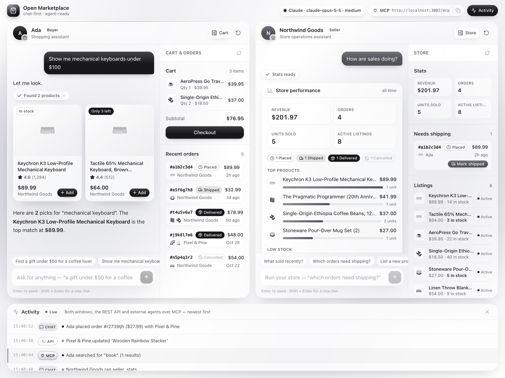

<p align="center">
  <a href="https://github.com/BrandeisPatrick/open-marketplace">
    
  </a>
</p>

<h1 align="center">Open Marketplace</h1>

<p align="center">
  The open-source, AI-first marketplace.<br>
  Chat is the storefront, every action is a tool, and any agent can shop or sell over MCP.
</p>

<p align="center">
  <a href="docs/getting-started.md">Getting started</a> ·
  <a href="docs/README.md">Documentation</a> ·
  <a href="docs/mcp.md">MCP guide</a> ·
  <a href="docs/tools.md">Tools</a> ·
  <a href="#roadmap">Roadmap</a> ·
  <a href="https://github.com/BrandeisPatrick/open-marketplace/issues">Issues</a>
</p>

<p align="center">
  <a href="https://github.com/BrandeisPatrick/open-marketplace/actions/workflows/ci.yml"></a>
  <a href="https://github.com/BrandeisPatrick/open-marketplace/releases/latest"></a>
  <a href="LICENSE"></a>
  
  <a href="https://modelcontextprotocol.io"></a>
  <a href="CONTRIBUTING.md"></a>
</p>

<p align="center">
  <picture>
    <source media="(prefers-color-scheme: dark)" srcset=".github/assets/screenshot-dark.png">
    
  </picture>
</p>

## What is Open Marketplace?

Open Marketplace is a two-sided, Amazon-style marketplace where chat is the interface. Buyers shop by talking to a shopping assistant, and sellers run their store by talking to an operations assistant. Every marketplace action is a tool: one registry of tools drives both the in-app Claude assistants and a built-in MCP server, so an external agent such as Claude Code or Claude Desktop can shop or sell through exactly the same actions a person uses in chat.

## Features

- **Chat-first buyer and seller windows.** Each side has its own assistant, and tool results render as product grids, carts, order cards and stats tiles instead of plain text.
- **One tool registry for chat and MCP.** 16 tools, each a zod schema plus a handler, with the same validation, buyer and seller scope checks and events on either path.
- **MCP server built in.** Stateless Streamable HTTP at `/mcp`, with tools, resources and prompts. A token picks whether the agent acts as the buyer or the seller.
- **Live across windows.** An order placed in the Buyer window, or by an external agent, appears in the Seller window and the Activity feed immediately.
- **Runs without an API key.** With no `ANTHROPIC_API_KEY`, the UI, REST API and MCP server work normally and chat falls back to an offline keyword helper.
- **Nothing to run besides Node.** The database is SQLite through Node's built-in `node:sqlite`, so there is no database server and no native addon to compile.

## Getting started

You need Node.js 22.13 or newer.

```bash
git clone https://github.com/BrandeisPatrick/open-marketplace.git
cd open-marketplace
cp .env.example .env      # optional: set ANTHROPIC_API_KEY to turn on the Claude assistants
npm install
npm run dev               # API and MCP on http://localhost:3001, UI on http://localhost:5173
```

Open **http://localhost:5173** and click *Show me mechanical keyboards* in the Buyer window. The database is seeded on first run with demo accounts, products and order history. The [getting started guide](docs/getting-started.md) covers offline mode and a five-minute demo.

## Connect an AI agent

With the server running, add it to Claude Code as an MCP server:

```bash
claude mcp add --transport http marketplace http://localhost:3001/mcp --header "Authorization: Bearer mk_buyer_demo"
```

Then ask the agent to *buy a coffee mug under $20 from the marketplace*. The purchase lands in the Seller window and the Activity feed with an MCP badge, exactly like one made in chat. The [MCP guide](docs/mcp.md) covers the seller token, Claude Desktop, raw JSON-RPC with curl, and the resources and prompts the server exposes.

## Documentation

| Guide | What it covers |
|---|---|
| [Getting started](docs/getting-started.md) | Requirements, install, offline mode, demo accounts and a five-minute demo |
| [Connect an agent over MCP](docs/mcp.md) | Endpoint, tokens, client setup, resources and prompts |
| [Marketplace tools](docs/tools.md) | All 16 tools by scope, and the conventions they share |
| [Architecture](docs/architecture.md) | How chat, MCP, the tool registry and live events fit together, with a diagram |
| [Configuration and scripts](docs/configuration.md) | Environment variables and npm scripts |
| [Contract](docs/CONTRACT.md) | The exact data model, JSON shapes, REST routes and streaming protocol |

## Repository structure

| Path | What it holds |
|---|---|
| [`server/`](server) | REST API, chat agents and MCP server: Express 5, TypeScript and `node:sqlite` |
| [`web/`](web) | Web UI: Vite, React 19 and Tailwind CSS 4 |
| [`docs/`](docs) | Guides and the shared contract |
| [`.github/`](.github) | CI workflow, issue forms, pull request template and brand assets |

The server also uses the Anthropic TypeScript SDK, the MCP TypeScript SDK and zod, and is tested with vitest. [Architecture](docs/architecture.md#repository-structure) has the full annotated tree.

## Roadmap

- Real accounts and OAuth for MCP clients instead of demo tokens
- Payments in test mode and per-user shipping addresses
- Product photos and buyer-written reviews
- Semantic search next to the keyword ranking
- Sales trends over time and proactive low-stock alerts for sellers
- A hosted demo

## Community and support

- **Questions, bugs and ideas:** open an [issue](https://github.com/BrandeisPatrick/open-marketplace/issues/new/choose) using the bug report or feature request form.
- **Security:** Open Marketplace is a local demo with public demo tokens, no real authentication and no real payments, so do not expose it to the internet as is. Report vulnerabilities privately as described in [SECURITY.md](SECURITY.md).
- **Releases:** see the [changelog](CHANGELOG.md) and the [releases page](https://github.com/BrandeisPatrick/open-marketplace/releases).

## Contributing

Contributions are welcome. [CONTRIBUTING.md](CONTRIBUTING.md) covers setup, how to add a marketplace tool and the pull request checklist, and [AGENTS.md](AGENTS.md) is the short version for AI coding agents. Please follow the [Code of Conduct](CODE_OF_CONDUCT.md).

## License

[MIT](LICENSE) © 2026 BrandeisPatrick

---

Open Marketplace is an independent open-source project and a demo. It is not affiliated with, endorsed by or sponsored by Amazon or Anthropic. Product names are trademarks of their respective owners.
