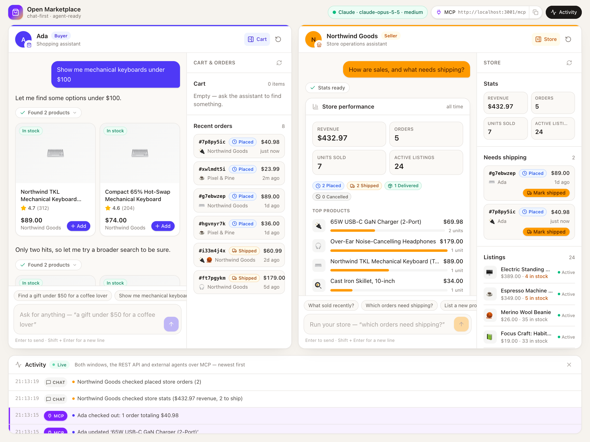
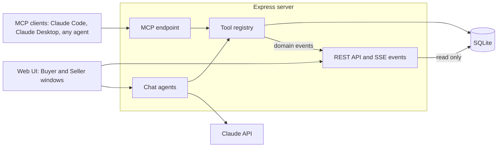

<div align="center">

# Open Marketplace

A two-sided marketplace where chat is the interface, and every action is a tool that both the in-app Claude assistants and any MCP client can call.

[](https://github.com/BrandeisPatrick/open-marketplace/actions/workflows/ci.yml)
[](LICENSE)

[](https://modelcontextprotocol.io)
[](CONTRIBUTING.md)

[Quick start](#quick-start) · [Connect over MCP](#connect-an-agent-over-mcp) · [Demo](#five-minute-demo) · [Tools](#tools) · [Architecture](#architecture) · [Configuration](#configuration) · [Contributing](#contributing)

</div>

<picture>
  <source media="(prefers-color-scheme: dark)" srcset="docs/screenshot-dark.png">
  
</picture>

Open Marketplace is an AI-first, Amazon-style two-sided marketplace where **chat is the interface**. Buyers shop by talking to a shopping assistant; sellers run their store by talking to an operations assistant. **Every marketplace action is a tool**: one registry of tools drives both the in-app assistants (Claude, through the Anthropic SDK) and an **MCP server**, so any external agent (Claude Code, Claude Desktop, a buyer's own agent) can shop or sell through exactly the same actions. The UI puts a **Buyer window and a Seller window side by side**, and anything that happens in one, or over MCP, shows up live in the other.

## Highlights

- **Chat-first buyer and seller windows.** Each side has its own Claude assistant, and tool results render as product grids, carts, order cards and stats tiles instead of plain text.
- **One tool registry for chat and MCP.** 16 tools, each a zod schema plus a handler, become both Anthropic tool definitions and MCP tools, with the same validation, scope checks and events on either path.
- **Live cross-window updates.** Domain events stream over Server-Sent Events, so an order placed in the Buyer window or by an external agent appears in the Seller window and the Activity feed immediately.
- **Runs without an API key.** With no `ANTHROPIC_API_KEY`, the UI, REST API and MCP server work normally and chat falls back to an offline keyword helper.
- **Nothing to install besides Node.** The database is SQLite through Node's built-in `node:sqlite`, so there is no database server to run and no native addon to compile.

## Requirements

- Node.js 22.13 or newer, and npm
- An Anthropic API key (optional; without one the app runs in offline mode)

## Quick start

```bash
cp .env.example .env      # then set ANTHROPIC_API_KEY=sk-ant-...
npm install
npm run dev               # API + MCP on http://localhost:3001, UI on http://localhost:5173
```

Open **http://localhost:5173** (if that port is busy, Vite picks the next free one and prints it).

**No API key? It still runs.** Without `ANTHROPIC_API_KEY` the UI, REST API and MCP server work normally and the chat falls back to an offline keyword helper ("find a mechanical keyboard", "gifts under $50", "add the first one", "show my cart", "checkout"; for sellers "orders to ship", "how are sales?", "mark ord_… shipped"). The UI shows an offline banner, and the first reply explains how to turn the assistant on. Conversations belong to the mode that wrote them: add or remove the key and restart, and both windows start with a fresh history, so the offline helper's replies are never replayed to Claude as its own words.

The database is a single SQLite file (`data/marketplace.db`) seeded on first run with three demo actors, 33 products and some order history. Delete the file to start fresh.

| Actor | Role | MCP token |
|---|---|---|
| Ada | buyer | `mk_buyer_demo` |
| Northwind Goods | seller | `mk_seller_demo` |
| Pixel & Pine | second seller (so checkout can split orders) | none |

## Connect an agent over MCP

The server speaks MCP over stateless Streamable HTTP at `http://localhost:3001/mcp`. The bearer token picks who the agent acts as; with no token it is the demo buyer.

**Claude Code**

```bash
claude mcp add --transport http marketplace http://localhost:3001/mcp --header "Authorization: Bearer mk_buyer_demo"
```

Use `mk_seller_demo` instead to run the Northwind Goods store.

**Claude Desktop** (`claude_desktop_config.json`, via the `mcp-remote` bridge)

```json
{
  "mcpServers": {
    "marketplace": {
      "command": "npx",
      "args": ["mcp-remote", "http://localhost:3001/mcp", "--header", "Authorization: Bearer mk_buyer_demo"]
    }
  }
}
```

**Raw JSON-RPC with curl** (stateless, so no session or `initialize` handshake is required):

```bash
curl -s http://localhost:3001/mcp \
  -H 'Content-Type: application/json' \
  -H 'Accept: application/json, text/event-stream' \
  -H 'Authorization: Bearer mk_buyer_demo' \
  -d '{"jsonrpc":"2.0","id":1,"method":"tools/call","params":{"name":"search_products","arguments":{"query":"mechanical keyboard","max_price":100}}}'
```

Besides tools, the server exposes resources (`marketplace://products`, `marketplace://products/{id}`, `marketplace://orders`) and prompts (`shopping_assistant` with a `need` argument for buyers, `seller_briefing` for sellers). Actions taken over MCP appear in the app's Activity feed with an MCP badge.

## Five-minute demo

1. **Buyer window:** click *Show me mechanical keyboards*. The assistant searches and the reply comes back as product cards; press **Add** on one, then say *checkout*.
2. **Seller window:** the new order appears in *Needs shipping* the moment it is placed. Ask *Which orders need shipping?* and press **Mark shipped** on the card.
3. **External agent:** run the curl command above (or ask Claude Code, once the MCP server is added, to *buy a coffee mug under $20 from the marketplace*). The purchase lands in the Activity feed with an **MCP** badge and in the seller window, exactly like one made in chat.
4. **Seller agent:** connect with `mk_seller_demo` and ask the agent *how are sales, and what is low on stock?* It answers with the same `seller_stats` tool the in-app assistant uses.

## Tools

Prices in tool inputs are US dollars; outputs always carry integer cents plus a formatted string.

| Tool | Scope | Purpose |
|---|---|---|
| `search_products` | buyer | Keyword search over titles, descriptions, tags and categories, with price, category and stock filters and sorting |
| `get_product` | buyer | Full details for one product |
| `add_to_cart` | buyer | Add a product (or more units of it) to the cart, within available stock |
| `remove_from_cart` | buyer | Remove a product line from the cart |
| `view_cart` | buyer | Cart lines, quantities and subtotal |
| `checkout` | buyer | Place the order: one order per seller, flat $5.99 shipping under $35, stock decremented, cart emptied |
| `list_orders` | buyer | The buyer's orders, newest first |
| `get_order` | buyer | One order with items and status |
| `cancel_order` | buyer | Cancel an order that has not shipped; stock is restored |
| `create_listing` | seller | Publish (or save as a draft) a new listing |
| `update_listing` | seller | Change price, stock, copy, category, tags or status of an own listing |
| `list_my_listings` | seller | The seller's listings with stock and status |
| `get_seller_orders` | seller | Orders placed with the store, filterable by status |
| `update_order_status` | seller | Advance an order: placed → shipped → delivered |
| `seller_stats` | seller | Revenue, orders by status, units sold, top products, low stock, orders to ship |
| `list_categories` | any | Categories with active product counts |

## Architecture



- **One tool registry** (`server/src/marketplace/tools.ts`). Each tool is a zod schema plus a handler. The same definitions become Anthropic tool definitions (JSON Schema via `z.toJSONSchema`) and MCP tools (`registerTool`), and every call from either side goes through one `executeTool` path: input validation, buyer/seller scope checks, domain events and a one-line activity summary.
- **Chat agents** (`server/src/agent`). A streaming manual tool-use loop on the Anthropic SDK (default `claude-opus-5-5` at `medium` effort): text streams to the browser as it is generated, every tool call runs through the registry, and the full message history is stored per demo actor so conversations survive restarts. The system prompt and tool definitions are cached. Rules such as "never check out unless the shopper explicitly asked or confirmed" live in the system prompt and the tool descriptions.
- **MCP server** (`server/src/mcp`). A fresh `McpServer` per request on a stateless Streamable HTTP transport; the caller's token decides which tools exist.
- **REST API** (`server/src/routes`). Read-only routes for the side panels (products, cart, orders, listings, stats) read the store directly; every marketplace change (cart, orders, listings) goes through a tool call from chat or MCP.
- **SQLite** through Node's built-in `node:sqlite`, with no native modules.
- **Live updates.** A domain event bus fans out over Server-Sent Events (`GET /api/events`), which is how the Seller window sees an order the moment a buyer, or a buyer's agent, places it. Chat replies stream over SSE from `POST /api/chat`.
- **Web UI** (`web/`): Vite, React 19, TypeScript and Tailwind 4. It renders cards (product grids, cart, orders, stats) from the assistants' tool results.

The exact JSON shapes, REST routes and streaming protocol are documented in [`docs/CONTRACT.md`](docs/CONTRACT.md).

## Configuration

Settings are read from environment variables; `npm run dev` and `npm start` load them from `.env` in the repo root when the file exists. Copy [`.env.example`](.env.example) to get started.

| Variable | Default | Meaning |
|---|---|---|
| `ANTHROPIC_API_KEY` | (empty) | Enables the AI assistants; without it chat runs in offline mode |
| `PORT` | `3001` | Server port (the Vite dev server proxies `/api` and `/mcp` here) |
| `MARKETPLACE_MODEL` | `claude-opus-5-5` | Claude model for both assistants |
| `MARKETPLACE_EFFORT` | `medium` | `low`, `medium`, `high`, `xhigh` or `max` |
| `MARKETPLACE_FALLBACKS` | `0` | `1` turns on server-side refusal fallbacks (beta) for chat requests |
| `MARKETPLACE_DB` | `data/marketplace.db` | SQLite file (`:memory:` works for throwaway runs) |

## Scripts

| Command | What it does |
|---|---|
| `npm run dev` | Server (watch mode, port 3001) and web UI (Vite, port 5173) together |
| `npm start` | Server only; also serves the built UI from `web/dist` if it exists |
| `npm run build` | Builds the web UI and typechecks the server |
| `npm test` | Server test suite (vitest) |
| `npm run typecheck` | Typechecks both packages |
| `npm run mock -w web` | Dependency-free mock of the server for UI work (see [CONTRIBUTING.md](CONTRIBUTING.md)) |

## Project layout

```
.
├── .github/              CI workflow, issue forms and pull request template
├── docs/
│   └── CONTRACT.md       Shared contract: data model, JSON shapes, REST, SSE and MCP
├── server/               API, chat agents and MCP server (Express 5, TypeScript)
│   ├── src/
│   │   ├── agent/        Claude tool-use loop, offline keyword helper, system prompts
│   │   ├── marketplace/  Tool registry, store (SQL and marketplace rules), seed data, types
│   │   ├── mcp/          MCP server built from the tool registry
│   │   ├── routes/       Express routers: REST and SSE, chat, MCP
│   │   └── index.ts      App setup and server entry point
│   └── test/             vitest suites
├── web/                  Web UI (Vite, React 19, Tailwind 4)
│   ├── scripts/          mock-api.mjs, a stand-in server for UI work
│   └── src/
│       ├── components/   App shell, chat windows, result cards, side panels
│       ├── hooks/        Chat streaming, live events, health, panel data
│       └── lib/          Formatting, tool labels, type guards
└── data/                 SQLite database, created on first run (git-ignored)
```

## Testing

```bash
npm run typecheck   # both packages
npm test            # server test suite
npm run build       # web build plus server typecheck
```

The server suite has 52 tests in 6 files. They cover search ranking and filters, the cart, checkout (per-seller order split, shipping, stock) and cancellation, seller scope enforcement, listings, order status transitions and seller stats, the REST API, the MCP server over Streamable HTTP, the offline helper, transcript replay, and the Claude tool-use loop against a mock Messages API. Every test file gets a fresh in-memory database, HTTP tests listen on an ephemeral port, and no test calls the real Anthropic API. CI runs typecheck, tests and build on Node 22, 24 and 26.

## Roadmap

- Real accounts and OAuth for MCP clients instead of demo tokens
- Payments in test mode and per-user shipping addresses
- Product photos and buyer-written reviews
- Semantic search next to the keyword ranking
- Sales trends over time and proactive low-stock alerts for sellers
- A hosted demo

## Contributing

Contributions are welcome. Read [CONTRIBUTING.md](CONTRIBUTING.md) for setup, how to add a marketplace tool and the pull request checklist, and follow the [Code of Conduct](CODE_OF_CONDUCT.md).

## Security

Open Marketplace is a local demo: demo accounts are selected by public tokens, there is no real authentication and no real payment processing, so do not expose it to the internet as is. To report a vulnerability privately, see [SECURITY.md](SECURITY.md).

## License

[MIT](LICENSE) © 2026 BrandeisPatrick

---

Open Marketplace is an independent open-source project and a demo. It is not affiliated with, endorsed by or sponsored by Amazon or Anthropic. Product names are trademarks of their respective owners.
