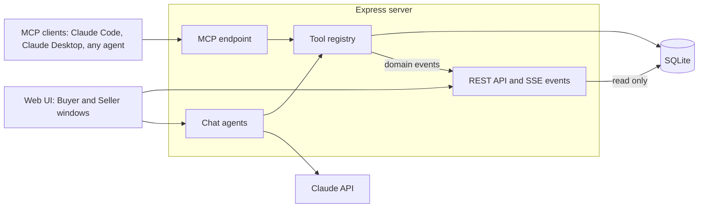

# Architecture

How the web UI, chat agents, MCP server, tool registry and SQLite database fit together, where each part lives and how it is tested.

## Overview

The Express server hosts three entry points: a REST API with a Server-Sent Events stream for the web UI, the chat agents, and the MCP endpoint for external agents. Chat and MCP both call the same tool registry, which is the only path that changes marketplace state.



## Components

- **One tool registry** (`server/src/marketplace/tools.ts`). Each tool is a zod schema plus a handler. The same definitions become Anthropic tool definitions (JSON Schema via `z.toJSONSchema`) and MCP tools (`registerTool`), and every call from either side goes through one `executeTool` path: input validation, buyer/seller scope checks, domain events and a one-line activity summary. See [Marketplace tools](tools.md).
- **Chat agents** (`server/src/agent`). A streaming manual tool-use loop on the Anthropic SDK (default `claude-opus-5-5` at `medium` effort): text streams to the browser as it is generated, every tool call runs through the registry, and the full message history is stored per demo actor so conversations survive restarts. The system prompt and tool definitions are cached. Rules such as "never check out unless the shopper explicitly asked or confirmed" live in the system prompt and the tool descriptions.
- **MCP server** (`server/src/mcp`). A fresh `McpServer` per request on a stateless Streamable HTTP transport; the caller's token decides which tools exist. See [Connect an agent over MCP](mcp.md).
- **REST API** (`server/src/routes`). Read-only routes for the side panels (products, cart, orders, listings, stats) read the store directly; every marketplace change (cart, orders, listings) goes through a tool call from chat or MCP.
- **SQLite** through Node's built-in `node:sqlite`, with no native modules.
- **Live updates.** A domain event bus fans out over Server-Sent Events (`GET /api/events`), which is how the Seller window sees an order the moment a buyer, or a buyer's agent, places it. Chat replies stream over SSE from `POST /api/chat`.
- **Web UI** (`web/`): Vite, React 19, TypeScript and Tailwind 4. It renders cards (product grids, cart, orders, stats) from the assistants' tool results.

The exact JSON shapes, REST routes and streaming protocol are documented in [`CONTRACT.md`](CONTRACT.md).

## Repository structure

```
.
├── .github/              CI workflow, issue forms, pull request template and brand assets
├── docs/                 Guides, starting at README.md
│   └── CONTRACT.md       Shared contract: data model, JSON shapes, REST, SSE and MCP
├── server/               API, chat agents and MCP server (Express 5, TypeScript)
│   ├── src/
│   │   ├── agent/        Claude tool-use loop, offline keyword helper, system prompts
│   │   ├── marketplace/  Tool registry, store (SQL and marketplace rules), seed data, types
│   │   ├── mcp/          MCP server built from the tool registry
│   │   ├── routes/       Express routers: REST and SSE, chat, MCP
│   │   └── index.ts      App setup and server entry point
│   └── test/             vitest suites
├── web/                  Web UI (Vite, React 19, Tailwind 4)
│   ├── scripts/          mock-api.mjs, a stand-in server for UI work
│   └── src/
│       ├── components/   App shell, chat windows, result cards, side panels
│       ├── hooks/        Chat streaming, live events, health, panel data
│       └── lib/          Formatting, tool labels, type guards
└── data/                 SQLite database, created on first run (git-ignored)
```

The logo, the README screenshots and the social preview image live in `.github/assets/`, and `web/public/` holds the favicon.

## Testing

```bash
npm run typecheck   # both packages
npm test            # server test suite
npm run build       # web build plus server typecheck
```

The server suite has 52 tests in 6 files. They cover search ranking and filters, the cart, checkout (per-seller order split, shipping, stock) and cancellation, seller scope enforcement, listings, order status transitions and seller stats, the REST API, the MCP server over Streamable HTTP, the offline helper, transcript replay, and the Claude tool-use loop against a mock Messages API.

Every test file gets a fresh in-memory database, HTTP tests listen on an ephemeral port, and no test calls the real Anthropic API. CI runs typecheck, tests and build on Node 22, 24 and 26.

## See also

- [Marketplace tools](tools.md)
- [Connect an agent over MCP](mcp.md)
- [Configuration and scripts](configuration.md)
- [Shared contract](CONTRACT.md)
- [Contributing guide](../CONTRIBUTING.md)
